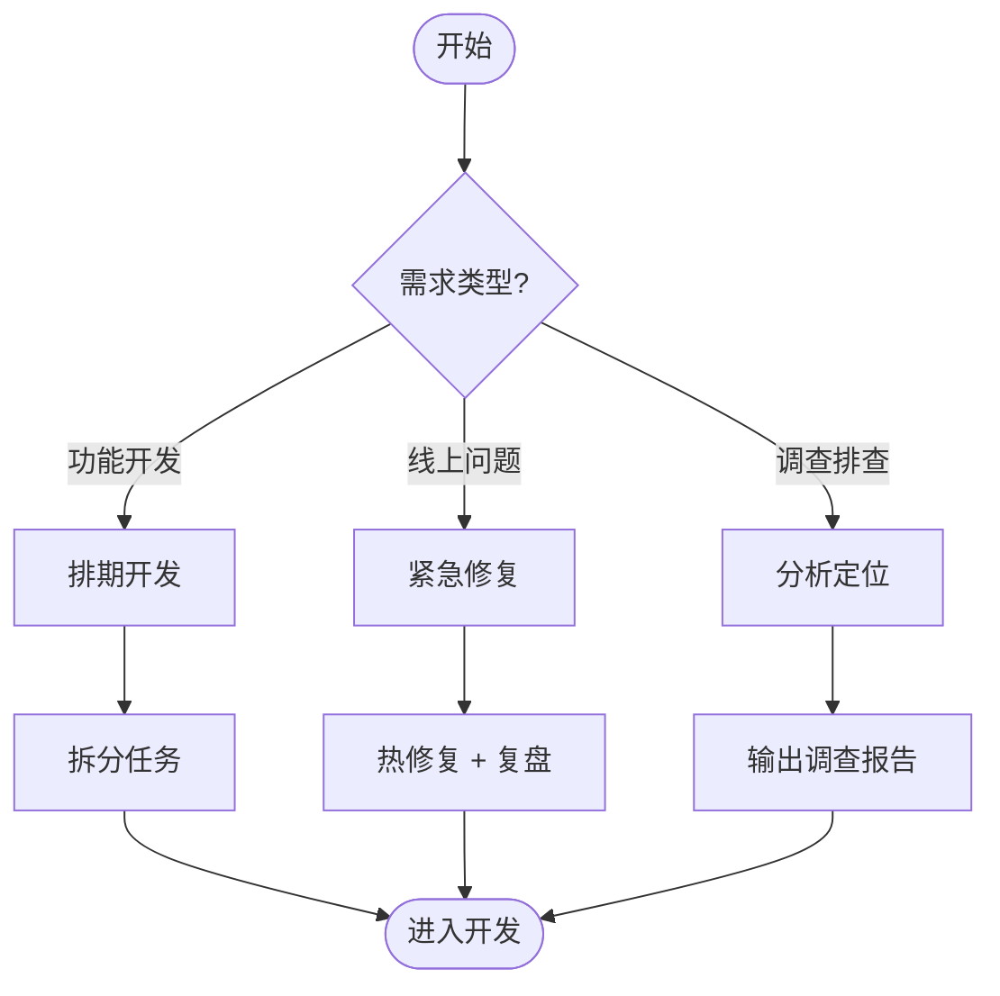
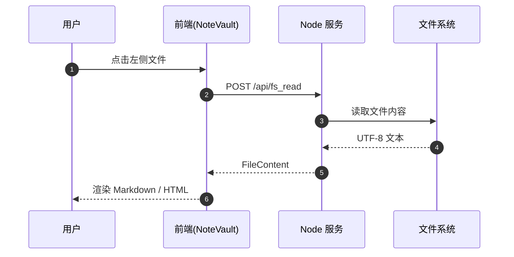
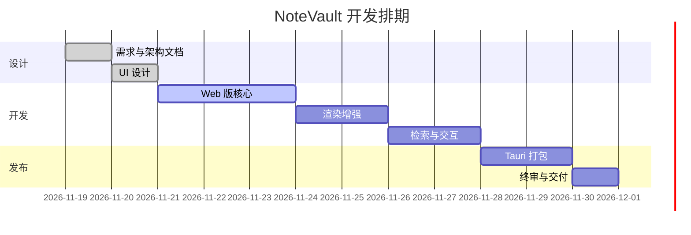
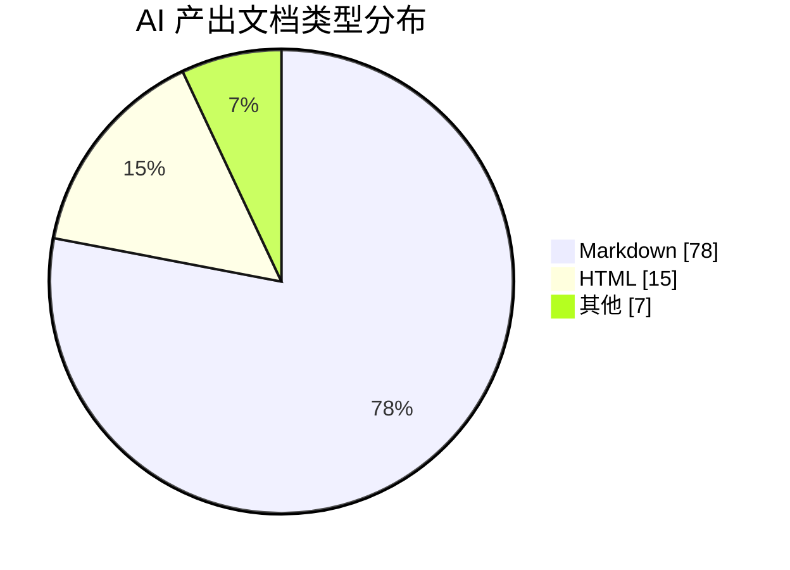
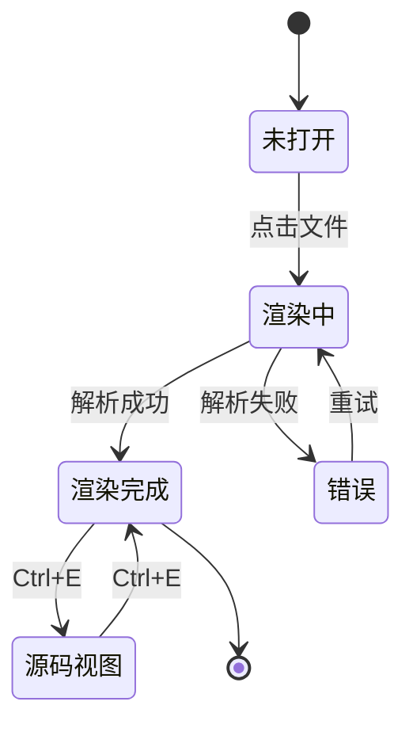

# Mermaid 图表示例

AI 工具产出的 Markdown 中最常见的图就是 Mermaid。本文用于验证 NoteVault 的 Mermaid 渲染（主题联动、多类型）。

## 1. 流程图（flowchart）

## 2. 时序图（sequence）

## 3. 甘特图（gantt）

## 4. 饼图（pie）

## 5. 状态图（state）

> 提示：切换深色/浅色主题时，以上图表会跟随主题重新渲染。
